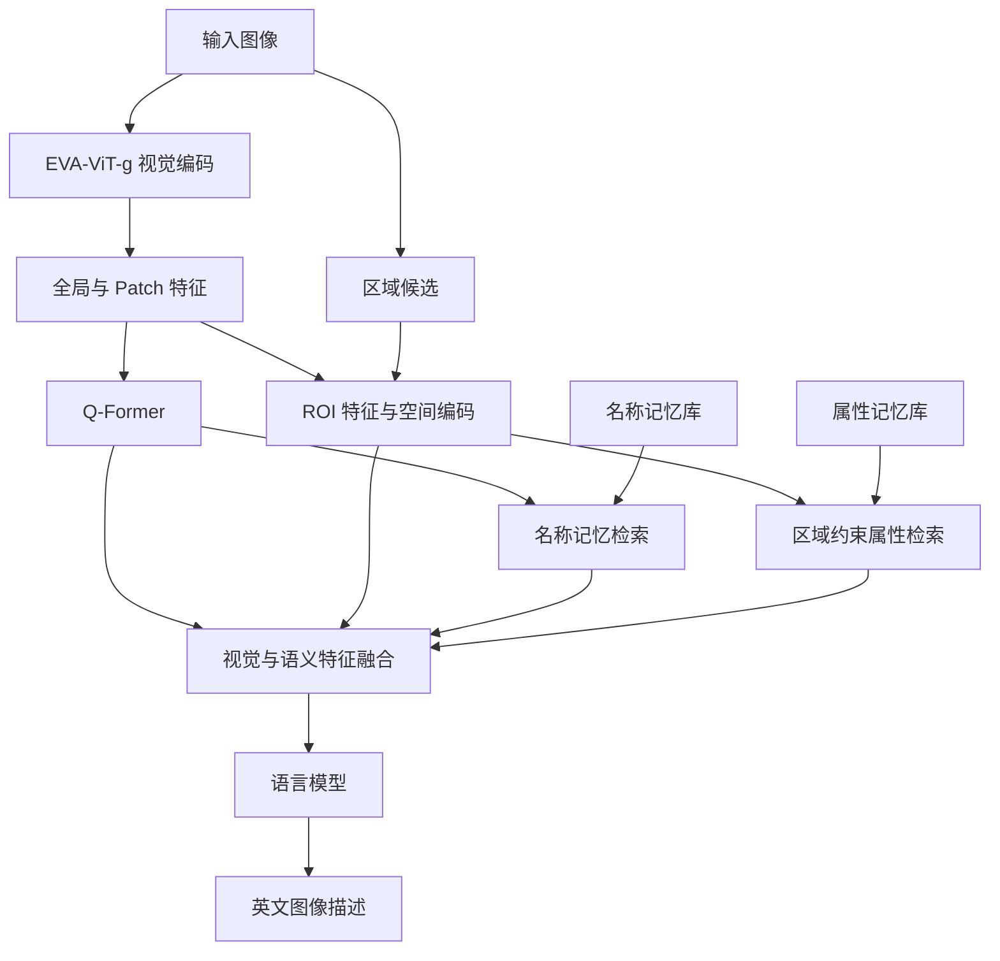

# DRAMCAP

融合区域视觉特征、空间信息与外部名称／属性记忆的图像描述生成框架。

DRAMCAP 使用 EVA-ViT-g 提取图像特征，通过 Q-Former、区域特征建模和外部记忆检索，将视觉信息与物体语义结合，再由语言模型生成英文图像描述。仓库提供 COCO 训练、单图与批量推理，以及 COCO 和 Flickr30k 评测入口。

## 主要功能

- **全局与区域视觉建模**：提取全局、Patch 和 ROI 特征，结合区域信息生成描述。
- **外部名称记忆检索**：从名称记忆库中检索物体语义，补充视觉表示。
- **区域约束属性检索**：根据 ROI 特征和物体类别检索属性，建立物体与属性的对应关系。
- **空间信息编码**：编码区域位置及区域之间的空间关系。
- **在线区域检测**：`infer.py` 支持使用 YOLOe 获取区域候选，并提供网格区域回退。
- **多种推理入口**：支持单图、图像目录、COCO 测试集和 Flickr30k 推理。

## 方法概览



训练入口可读取 COCO 实例标注获取区域；`infer.py` 使用 YOLOe 检测区域，检测器未加载时回退到网格区域。

当前视觉前端加载 EVA-ViT-g。默认语言模型路径指向 Vicuna-7B-v1.5，解码器根据模型配置识别 Llama 或 Mistral 类型。

## 仓库结构

```text
DRAMCAP/
├── attr_memory/
│   ├── attr_memory.pkl           # 属性记忆库
│   └── name2attr_topk.json        # 物体名称与属性的映射
├── caption_model/
│   ├── model.py                  # 图像描述模型主体
│   ├── vision_frontend.py        # EVA 视觉前端
│   ├── qformer.py                # BLIP-2 Q-Former
│   ├── retrieval_qformer.py      # 检索相关 Q-Former
│   ├── retriever.py              # 名称与属性记忆检索
│   ├── roi_pipeline.py           # ROI 特征处理
│   ├── fusion.py                 # 特征融合模块
│   ├── auxiliary.py              # 辅助网络模块
│   ├── decoder.py                # 语言模型解码器
│   └── ...
├── build_attr_memory_mean.py     # 属性记忆库构建
├── classify_vg_attrs.py          # Visual Genome 属性分类
├── config.yaml                  # 路径与模型、训练配置
├── config.py                    # 配置加载入口
├── config_loader.py             # 配置类及兼容加载逻辑
├── ext_memory_lvis.pkl           # 外部名称记忆库
├── lavis_eva_vit.py              # 内嵌 EVA-ViT-g 实现
├── spatial_encoding.py          # 空间编码
├── losses.py                    # 训练损失
├── train.py                     # COCO 训练入口
├── infer.py                     # 单图、批量及 COCO 推理
├── infer_flickr.py              # Flickr30k 推理与评测
├── run.sh                       # Bash 辅助脚本
└── eval_results_v621_yoloe.json  # 已保存的预测结果
```

## 环境准备

代码主要面向 CUDA GPU 环境，包含 BF16 运算。训练批大小和推理批大小需要根据显存调整。

### 获取代码

```bash
git clone https://github.com/wh10990448-commits/DRAMCAP.git
cd DRAMCAP
```

也可以下载仓库 ZIP，解压后进入项目目录。

### 安装依赖

先根据 GPU 和 CUDA 环境安装匹配的 `torch`、`torchvision`，再安装主要 Python 依赖：

```bash
pip install transformers numpy Pillow PyYAML tqdm sentencepiece ultralytics
```

评测相关依赖：

```bash
pip install pycocotools pycocoevalcap
```

重新进行属性分类时，还可安装：

```bash
pip install sentence-transformers
```

完整评测中的 PTBTokenizer、METEOR 和 SPICE 等组件涉及 Java，请准备相应运行环境。

仓库目前未提供依赖版本锁定文件，具体版本需要与 PyTorch、Transformers 及本地模型权重保持兼容。

## 模型与记忆库准备

运行前需要准备以下资源：

| 资源 | 用途 | 配置位置或参数 |
| --- | --- | --- |
| `eva_vit_g.pth` | EVA-ViT-g 视觉编码器 | `paths.eva_vit_g_model` |
| Vicuna 等兼容语言模型 | 文本解码及分词 | `paths.llm_path` |
| BLIP-2 预训练权重 | Q-Former 初始化 | `paths.blip2_qformer_path` |
| `ext_memory_lvis.pkl` | 名称检索 | `paths.name_pkl` |
| `attr_memory.pkl` | 属性检索 | `paths.attr_pkl` |
| `name2attr_topk.json` | 名称与属性映射 | `paths.attr_map` |
| 训练得到的描述模型 checkpoint | 推理 | `--checkpoint` 或 `--resume` |

仓库提供名称与属性记忆文件。视觉编码器、语言模型、BLIP-2 权重和训练得到的模型 checkpoint 需要自行准备。

语言模型目录应包含 Hugging Face 格式的模型配置、权重及 tokenizer 文件。

## 配置路径

保留现有 `config.yaml` 的完整结构，并修改 `paths` 中的对应字段。以下展示主要路径字段：

```yaml
paths:
  project_dir: /path/to/DRAMCAP

  llm_path: /path/to/models/vicuna-7b-v1.5
  eva_vit_g_model: /path/to/models/eva_vit_g.pth
  eva01_model: /path/to/models/eva_vit_g.pth
  blip2_qformer_path: /path/to/models/blip2_pretrained_flant5xxl.pth

  name_pkl: /path/to/DRAMCAP/ext_memory_lvis.pkl
  attr_pkl: /path/to/DRAMCAP/attr_memory/attr_memory.pkl
  attr_map: /path/to/DRAMCAP/attr_memory/name2attr_topk.json

  coco_train_images: /path/to/data/coco_2014
  coco_val_images: /path/to/data/coco_2014
  coco_train_captions: /path/to/data/coco_karpathy_train.json
  coco_val_captions: /path/to/data/coco_karpathy_val.json
  coco_karpathy_train_json: /path/to/data/coco_karpathy_train.json

  lvis_train_json: /path/to/data/coco_2014/annotations/instances_train2014.json
  lvis_val_json: /path/to/data/coco_2014/annotations/instances_val2014.json

  output_dir: /path/to/DRAMCAP/outputs
  features_dir: /path/to/DRAMCAP/outputs/features
  checkpoint_dir: /path/to/DRAMCAP/outputs/checkpoints
  log_dir: /path/to/DRAMCAP/outputs/logs
```

`lvis_train_json` 和 `lvis_val_json` 是保留的历史字段名；当前 COCO 配置中，它们实际指向 COCO 实例标注。

训练轮数、批大小、梯度累积和学习率等参数位于 `training` 配置段。

## COCO 数据准备

训练使用 COCO 2014 图像与 Karpathy 划分。图像目录应保留以下结构：

```text
coco_2014/
├── train2014/
├── val2014/
└── annotations/
    ├── instances_train2014.json
    └── instances_val2014.json
```

训练用 Karpathy JSON 支持扁平列表格式，每条记录对应一条描述：

```json
[
  {
    "caption": "A person riding a bicycle on a street.",
    "image": "train2014/COCO_train2014_000000000001.jpg",
    "image_id": "coco_1"
  }
]
```

上面仅为格式示例。实际标注中的图片名称必须与数据集一致。

当 `image` 字段包含 `train2014/` 或 `val2014/` 前缀时，训练的图片根目录应指向它们的共同父目录 `coco_2014/`。

Karpathy 训练集包含来自 COCO 原始 train 和 val 的图像，因此应同时准备两份实例标注。

## 训练

完成配置后，可以运行：

```bash
python train.py \
  --ablation full \
  --image_dir /path/to/data/coco_2014 \
  --train_json /path/to/data/coco_karpathy_train.json \
  --lvis_json /path/to/data/coco_2014/annotations/instances_train2014.json \
  --lvis_val_json /path/to/data/coco_2014/annotations/instances_val2014.json \
  --blip2_qformer_path /path/to/models/blip2_pretrained_flant5xxl.pth
```

当前训练入口使用下一词预测交叉熵损失，默认 `label_smoothing=0.0`，并在入口中将每图描述数量固定为 5。

加载已有 checkpoint 继续训练：

```bash
python train.py \
  --ablation full \
  --resume /path/to/checkpoints/stage2_ep1.pt
```

续训时仍需正确配置数据、预训练模型和记忆库路径。

训练输出包括：

- 模型 checkpoint：`stage2_ep*.pt`、`stage2_final.pt`。
- 训练日志及检索诊断信息。
- `config.yaml` 中指定的其他输出目录。

## 单张图像推理

```bash
python infer.py \
  --mode single \
  --checkpoint /path/to/checkpoints/stage2_ep1.pt \
  --image_path /path/to/example.jpg \
  --yoloe_path /path/to/models/yoloe/model.pt
```

如果需要使用网格区域进行推理：

```bash
python infer.py \
  --mode single \
  --checkpoint /path/to/checkpoints/stage2_ep1.pt \
  --image_path /path/to/example.jpg \
  --no_yoloe
```

可添加 `--no_retrieval_diag` 关闭详细检索诊断输出。

## 批量图像推理

```bash
python infer.py \
  --mode batch \
  --checkpoint /path/to/checkpoints/stage2_ep1.pt \
  --image_dir /path/to/images \
  --yoloe_path /path/to/models/yoloe/model.pt \
  --output_file batch_predictions.json \
  --max_images 100
```

`--max_images` 控制本次处理的图片数量上限。

## COCO 评测

```bash
python infer.py \
  --mode eval \
  --checkpoint /path/to/checkpoints/stage2_ep1.pt \
  --karpathy_json /path/to/data/coco_karpathy_test.json \
  --image_dir /path/to/data/coco_2014/val2014 \
  --yoloe_path /path/to/models/yoloe/model.pt \
  --output_file coco_predictions.json \
  --max_images 5000
```

请根据测试标注中的图片路径设置 `--image_dir`。

评测通过 COCO caption evaluation 工具计算 BLEU、METEOR、ROUGE-L、CIDEr 和 SPICE 等指标，具体取决于评测依赖是否安装完整。

## Flickr30k 推理与评测

```bash
python infer_flickr.py \
  --resume /path/to/checkpoints/stage2_ep1.pt \
  --karpathy_json /path/to/data/dataset_flickr30k.json \
  --image_dir /path/to/data/flickr30k-images \
  --split test \
  --output flickr30k_predictions.json \
  --batch_size 8
```

Flickr30k 入口使用 `--resume` 指定 checkpoint。

常用参数：

| 参数 | 作用 |
| --- | --- |
| `--max_images 100` | 限制处理数量，便于快速检查 |
| `--no_eval_metrics` | 仅生成描述 |
| `--skip_spice` | 跳过 SPICE |
| `--skip_meteor` | 跳过 METEOR |
| `--batch_size` | 调整推理批大小 |

## 属性记忆库构建

使用仓库已有的记忆库时，可以跳过此步骤。

需要重新构建时，准备 PACO、VAW、Visual Genome 等相关图像与标注，并根据实际数据来源选择构建参数。

查看属性分类脚本参数：

```bash
python classify_vg_attrs.py --help
```

查看属性记忆构建脚本参数：

```bash
python build_attr_memory_mean.py --help
```

这两个脚本包含独立的数据路径默认值。迁移到新环境时，需要通过命令行参数覆盖对应路径，或修改脚本中的路径配置。

## 使用说明

- 当前配置中保留了原开发环境的绝对路径，运行前需要替换。
- 本文命令使用 Bash 换行语法；在 Windows PowerShell 中可将命令合并为一行。
- `run.sh` 保留了对 `build_attr_memory.py`、`classify_vg_attrs_v2.py` 和 `verify_alignment.py` 的引用，当前仓库未包含这些同名文件。使用相关子命令前，需要调整引用或补齐脚本。
- 仓库中的 `eval_results_v621_yoloe.json` 是预测结果文件；模型表现应结合 checkpoint、数据划分及评测配置重新计算。

## 致谢

感谢 LAVIS、BLIP-2、EVCap，以及 COCO、Flickr30k、LVIS、PACO、VAW 和 Visual Genome 等相关工作与数据集。
