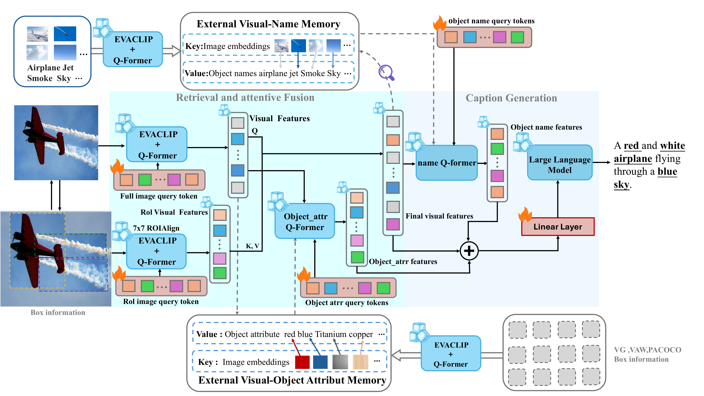
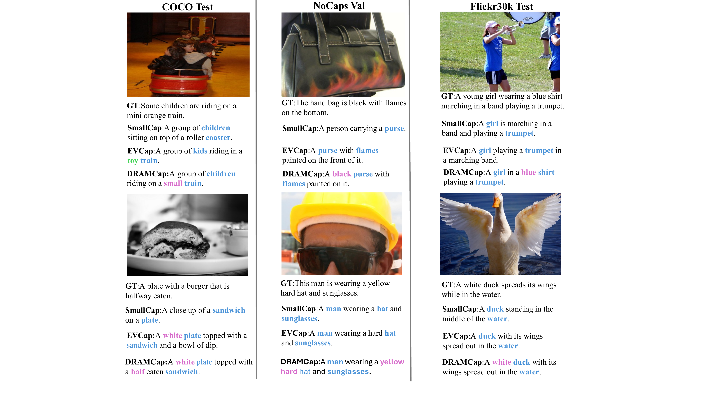

# DRAMCap: Dual-Directional ROI-Enhanced Image Captioning with Name-Attribute Dual-Memory Fusion

**Lulu Wang, Hao Wang, Ruoyu Zhang, Tongling Pan, Hai Sun, and Yingna Li**

## Abstract

Image captioning aims to generate fluent descriptions. Retrieval-augmented methods prompt a frozen LLM with external memory, but a single global embedding loses object details and causes misbinding, while the memory indexes only names, ignoring attributes. We propose DRAMCap, a dual-directional Region of Interest (ROI)-enhanced captioner. It has three core components: (1) region-level dual-memory query—pooled tokens vote for names openly, and each region retrieves attributes from its predicted class subset, eliminating misbinding; (2) a shared lightweight Q-Former for refinement and fusion—it processes retrieved names and attributes and concatenates them with the final visual features, encoding into marker-free continuous prompts for frozen Vicuna-7B; (3) global-ROI dual feedback flow—a novel bidirectional mechanism that mutually enhances global and regional features for refined representations. Our model, with only a 7B LLM, surpasses 13B image captioning models on evaluation metrics and performs well on Flickr30k, NoCaps, and WHOOPS. The code is available [here](https://github.com/wh10990448-commits/DRAMCAP).



*DRAMCap framework. Full-image and region-wise visual features interact with external name and attribute memories to condition the frozen language model. Flame and snowflake icons indicate trainable and frozen modules, respectively.*

## Overview

DRAMCap is a retrieval-augmented image captioning framework that combines regional visual evidence with external name and attribute memories. It conditions a frozen Vicuna-7B language model using refined visual and retrieved semantic features to generate detailed image descriptions.

The accompanying paper introduces three main components:

- **Region-level dual-memory retrieval:** open-vocabulary name retrieval and class-constrained attribute retrieval provide complementary evidence while reducing cross-object attribute binding errors.
- **Shared Q-Former refinement:** retrieved names and attributes are jointly refined and combined with visual features as a marker-free continuous prompt.
- **Global-ROI bidirectional fusion:** global and regional features exchange information, including a gated ROI-to-global feedback stream.

## Architecture

The paper uses a frozen EVA-CLIP visual encoder, a frozen Vicuna-7B-v1.5 language decoder, and a trainable retrieval-and-fusion pipeline. Region features are obtained through 7 x 7 ROI-Align and per-ROI Q-Former processing. The name memory follows the LVIS-derived memory used by EVCap; the attribute memory is constructed from Visual Genome, VAW, and PACO.

During training, COCO instance annotations provide regions. The paper uses predicted YOLOE regions at test time. In this code snapshot, `infer.py` supports YOLOe detection and falls back to grid regions when the detector is unavailable or explicitly disabled.

## Qualitative Examples



*Figure 3 from the accompanying paper. Captioning examples on COCO, NoCaps, and Flickr30k compare DRAMCap with SmallCap and EVCap. The original figure highlights object names, baseline modifiers, and fine-grained attributes.*

## Results Reported in the Paper

The following values are reported in Tables 1 and 3 of the accompanying manuscript for DRAMCap with Vicuna-7B, trained on COCO.

| Dataset / split | BLEU-4 | METEOR | CIDEr | SPICE |
| --- | ---: | ---: | ---: | ---: |
| COCO Karpathy test | 41.5 | 31.3 | 141.0 | 24.8 |
| Flickr30k Karpathy test | - | - | 84.6 | 18.4 |
| NoCaps validation, overall | - | - | 119.0 | 15.4 |
| WHOOPS | 24.9 | 26.1 | 85.8 | 17.9 |

The paper reports 19.5M trainable parameters, with the visual encoder and language model kept frozen. A dash means that the corresponding value is not listed in these paper tables.

This repository snapshot contains COCO training and inference, general image inference, and Flickr30k inference and evaluation. Dedicated NoCaps and WHOOPS evaluation scripts are not included. Reproducing paper results requires matching the checkpoints, memory banks, data splits, and inference settings.

## Repository Structure

```text
DRAMCAP/
├── assets/
│   ├── dramcap-framework.png      # High-resolution architecture figure
│   └── dramcap-examples.png       # Qualitative examples from the paper
├── attr_memory/
│   ├── attr_memory.pkl            # Attribute memory
│   └── name2attr_topk.json         # Object-to-attribute mapping
├── caption_model/
│   ├── model.py                   # Captioning model
│   ├── vision_frontend.py         # EVA visual frontend
│   ├── qformer.py                 # BLIP-2 Q-Former
│   ├── retrieval_qformer.py       # Retrieval Q-Former modules
│   ├── retriever.py               # Name and attribute retrieval
│   ├── roi_pipeline.py            # ROI feature processing
│   ├── fusion.py                  # Feature fusion
│   ├── auxiliary.py               # Auxiliary model components
│   ├── decoder.py                 # Language-model decoder
│   └── ...
├── build_attr_memory_mean.py      # Attribute-memory construction
├── classify_vg_attrs.py           # Visual Genome attribute classification
├── config.yaml                   # Paths and model/training configuration
├── config.py                     # Configuration-loading entry point
├── config_loader.py              # Configuration classes and compatibility logic
├── ext_memory_lvis.pkl            # External name memory
├── lavis_eva_vit.py               # Embedded EVA-ViT-g implementation
├── spatial_encoding.py           # Spatial encoding
├── losses.py                     # Training loss
├── train.py                      # COCO training
├── infer.py                      # Single-image, directory, and COCO inference
├── infer_flickr.py               # Flickr30k inference and evaluation
├── run.sh                        # Bash helper script
└── eval_results_v621_yoloe.json   # Saved predictions
```

## Installation

### Get the Code

```bash
git clone https://github.com/wh10990448-commits/DRAMCAP.git
cd DRAMCAP
```

Alternatively, download and extract the repository ZIP archive.

### Install Dependencies

The implementation primarily targets CUDA GPUs and uses BF16 operations. Install `torch` and `torchvision` versions appropriate for your GPU and CUDA environment, then install the main Python dependencies:

```bash
pip install transformers numpy Pillow PyYAML tqdm sentencepiece ultralytics
```

For caption evaluation:

```bash
pip install pycocotools pycocoevalcap
```

For embedding-based attribute classification:

```bash
pip install sentence-transformers
```

Full caption evaluation also requires a working Java runtime for components such as PTBTokenizer, METEOR, and SPICE.

The repository does not currently include a dependency lock file. Package versions must be compatible with the local PyTorch environment, Transformers APIs, and model checkpoints.

## Models and Memory Banks

Prepare the following resources before training or inference:

| Resource | Purpose | Configuration / argument |
| --- | --- | --- |
| `eva_vit_g.pth` | EVA-ViT-g visual encoder | `paths.eva_vit_g_model` |
| Vicuna-7B-v1.5 model directory | Language decoding and tokenization | `paths.llm_path` |
| BLIP-2 pretrained checkpoint | Q-Former initialization | `paths.blip2_qformer_path` |
| `ext_memory_lvis.pkl` | Name retrieval | `paths.name_pkl` |
| `attr_memory.pkl` | Attribute retrieval | `paths.attr_pkl` |
| `name2attr_topk.json` | Object-to-attribute mapping | `paths.attr_map` |
| Trained captioning checkpoint | Inference | `--checkpoint` or `--resume` |

The repository contains the name and attribute memory files. Prepare the visual encoder, language model, BLIP-2 weights, and trained captioning checkpoint separately. The language-model directory should contain the Hugging Face model configuration, weights, and tokenizer files.

## Configuration

Keep the existing structure of `config.yaml` and update its path fields. The following example shows the main fields to replace; it is not a complete replacement for the configuration file.

```yaml
paths:
  project_dir: /path/to/DRAMCAP

  llm_path: /path/to/models/vicuna-7b-v1.5
  eva_vit_g_model: /path/to/models/eva_vit_g.pth
  eva01_model: /path/to/models/eva_vit_g.pth
  blip2_qformer_path: /path/to/models/blip2_pretrained_flant5xxl.pth

  name_pkl: /path/to/DRAMCAP/ext_memory_lvis.pkl
  attr_pkl: /path/to/DRAMCAP/attr_memory/attr_memory.pkl
  attr_map: /path/to/DRAMCAP/attr_memory/name2attr_topk.json

  coco_train_images: /path/to/data/coco_2014
  coco_val_images: /path/to/data/coco_2014
  coco_train_captions: /path/to/data/coco_karpathy_train.json
  coco_val_captions: /path/to/data/coco_karpathy_val.json
  coco_karpathy_train_json: /path/to/data/coco_karpathy_train.json

  lvis_train_json: /path/to/data/coco_2014/annotations/instances_train2014.json
  lvis_val_json: /path/to/data/coco_2014/annotations/instances_val2014.json

  output_dir: /path/to/DRAMCAP/outputs
  features_dir: /path/to/DRAMCAP/outputs/features
  checkpoint_dir: /path/to/DRAMCAP/outputs/checkpoints
  log_dir: /path/to/DRAMCAP/outputs/logs
```

`lvis_train_json` and `lvis_val_json` are historical field names. In the current COCO configuration, they point to COCO instance annotations.

Training epochs, batch size, gradient accumulation, and learning rate are configured under `training`. Adjust batch sizes to fit the available GPU memory.

## COCO Data Preparation

Prepare COCO 2014 images and Karpathy-split caption annotations. Preserve the image-directory structure:

```text
coco_2014/
├── train2014/
├── val2014/
└── annotations/
    ├── instances_train2014.json
    └── instances_val2014.json
```

The training loader supports flat Karpathy-format caption records:

```json
[
  {
    "caption": "A person riding a bicycle on a street.",
    "image": "train2014/COCO_train2014_000000000001.jpg",
    "image_id": "coco_1"
  }
]
```

This record only illustrates the schema. Image names and captions must match the actual dataset.

When the `image` field includes a `train2014/` or `val2014/` prefix, set the training image root to their shared parent, `coco_2014/`. Karpathy training uses images from both original COCO subsets, so prepare both instance-annotation files.

## Training

After updating the configuration, run:

```bash
python train.py \
  --ablation full \
  --image_dir /path/to/data/coco_2014 \
  --train_json /path/to/data/coco_karpathy_train.json \
  --lvis_json /path/to/data/coco_2014/annotations/instances_train2014.json \
  --lvis_val_json /path/to/data/coco_2014/annotations/instances_val2014.json \
  --blip2_qformer_path /path/to/models/blip2_pretrained_flant5xxl.pth
```

The current entry point uses next-token prediction cross-entropy, defaults to `label_smoothing=0.0`, and fixes the number of captions per image to five.

To continue training from a checkpoint:

```bash
python train.py \
  --ablation full \
  --resume /path/to/checkpoints/stage2_ep1.pt
```

The data, pretrained-model, and memory-bank paths must remain correctly configured when continuing training. Checkpoints such as `stage2_ep*.pt` and `stage2_final.pt` are written to the configured checkpoint directory.

## Single-Image Inference

```bash
python infer.py \
  --mode single \
  --checkpoint /path/to/checkpoints/stage2_ep1.pt \
  --image_path /path/to/example.jpg \
  --yoloe_path /path/to/models/yoloe/model.pt
```

To use grid regions instead of detector proposals:

```bash
python infer.py \
  --mode single \
  --checkpoint /path/to/checkpoints/stage2_ep1.pt \
  --image_path /path/to/example.jpg \
  --no_yoloe
```

Add `--no_retrieval_diag` to disable detailed retrieval diagnostics.

## Directory Inference

```bash
python infer.py \
  --mode batch \
  --checkpoint /path/to/checkpoints/stage2_ep1.pt \
  --image_dir /path/to/images \
  --yoloe_path /path/to/models/yoloe/model.pt \
  --output_file batch_predictions.json \
  --max_images 100
```

`--max_images` limits the number of images processed in the run.

## COCO Evaluation

```bash
python infer.py \
  --mode eval \
  --checkpoint /path/to/checkpoints/stage2_ep1.pt \
  --karpathy_json /path/to/data/coco_karpathy_test.json \
  --image_dir /path/to/data/coco_2014/val2014 \
  --yoloe_path /path/to/models/yoloe/model.pt \
  --output_file coco_predictions.json \
  --max_images 5000
```

Set `--image_dir` to the directory that resolves the images referenced by your test annotations. Caption metrics are calculated through the COCO caption evaluation tools when their dependencies are available.

## Flickr30k Inference and Evaluation

```bash
python infer_flickr.py \
  --resume /path/to/checkpoints/stage2_ep1.pt \
  --karpathy_json /path/to/data/dataset_flickr30k.json \
  --image_dir /path/to/data/flickr30k-images \
  --split test \
  --output flickr30k_predictions.json \
  --batch_size 8
```

The Flickr30k entry point uses `--resume` to specify the captioning checkpoint.

| Argument | Purpose |
| --- | --- |
| `--max_images 100` | Run on a smaller subset |
| `--no_eval_metrics` | Generate captions without calculating metrics |
| `--skip_spice` | Skip SPICE |
| `--skip_meteor` | Skip METEOR |
| `--batch_size` | Set the inference batch size |

## Building the Attribute Memory

Skip this step when using the provided memory banks. To rebuild the attribute memory, prepare the relevant PACO, VAW, and Visual Genome images and annotations, and inspect the available arguments:

```bash
python classify_vg_attrs.py --help
python build_attr_memory_mean.py --help
```

These scripts have independent default data paths. Override them through command-line arguments or update their path definitions when moving to a new environment.

## Implementation Notes

- The supplied configuration and some script defaults contain absolute paths from the development environment. Replace them before running the code.
- The command examples use Bash line continuations. In Windows PowerShell, combine each command into one line or use PowerShell continuation syntax.
- `run.sh` retains references to `build_attr_memory.py`, `classify_vg_attrs_v2.py`, and `verify_alignment.py`. Those exact filenames are absent from this snapshot; update the references or provide the scripts before using the corresponding helper commands.
- `eval_results_v621_yoloe.json` contains saved predictions. Evaluate a matching checkpoint with the intended data split and inference protocol to obtain reproducible metrics.

## Acknowledgments

We acknowledge LAVIS, BLIP-2, EVCap, and the COCO, Flickr30k, LVIS, PACO, VAW, Visual Genome, NoCaps, and WHOOPS datasets and benchmarks. The figures illustrate the framework and qualitative results presented in the accompanying DRAMCap manuscript.
